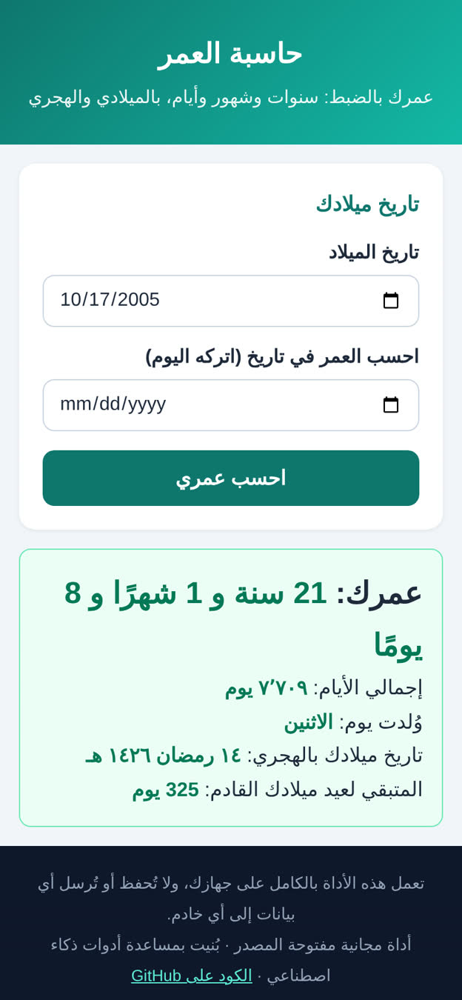

# Age Calculator | حاسبة العمر

Calculate your exact age in years, months and days, in both Gregorian and Hijri calendars. Arabic interface.

**Live app:** https://abood-ayman.github.io/age-calculator-ar/

**LinkedIn:** [Project entry](https://www.linkedin.com/in/abdullah-ayman-1678b737b/details/projects/)

This is a personal project, built with AI tools.

## Features
- Exact age in years, months and days between two dates
- Your birth date in the Hijri calendar and the weekday you were born
- Countdown in days to your next birthday
- Total number of days you have lived

## Privacy
Everything runs in your browser. No data is stored or sent anywhere.

## Run locally
Open `index.html` in any browser. It is a single static page with no dependencies.

## Status
Stable.

## Copyright
MIT License - Copyright (c) 2026 Abdullah Ayman.
